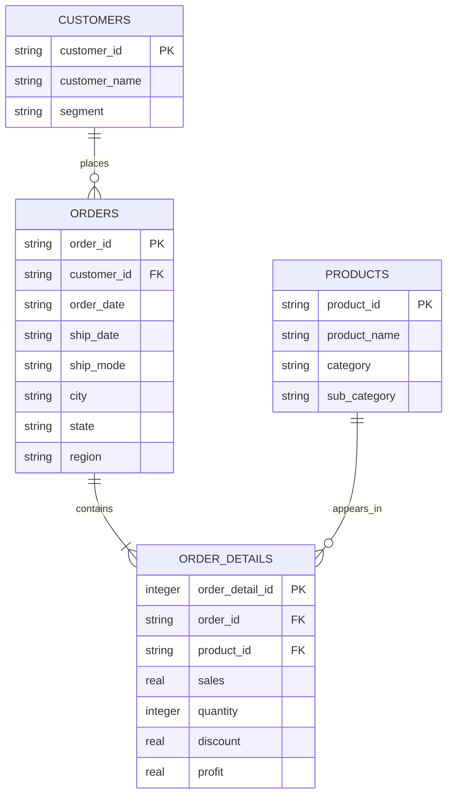

# Superstore Database ERD

The customers table connects to orders through customer_id.
The orders table connects to order_details through order_id.
The products table connects to order_details through product_id.
